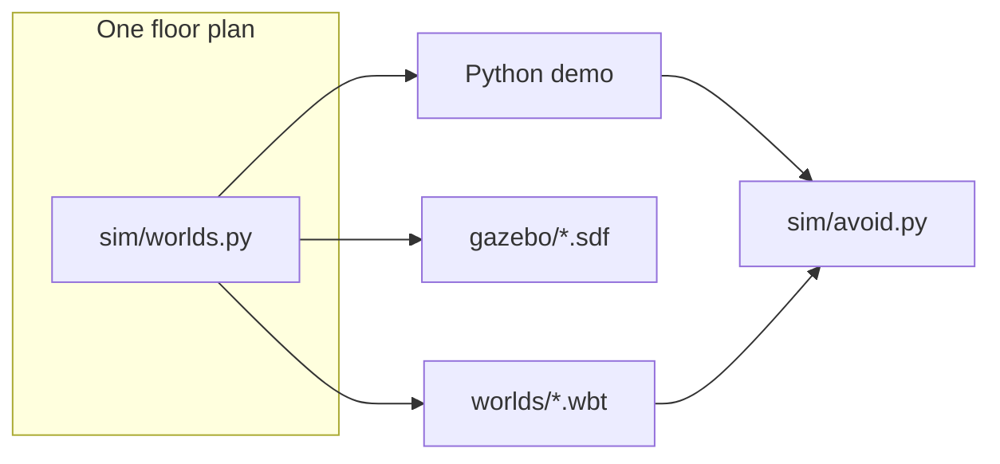
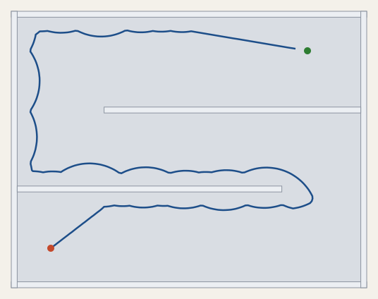
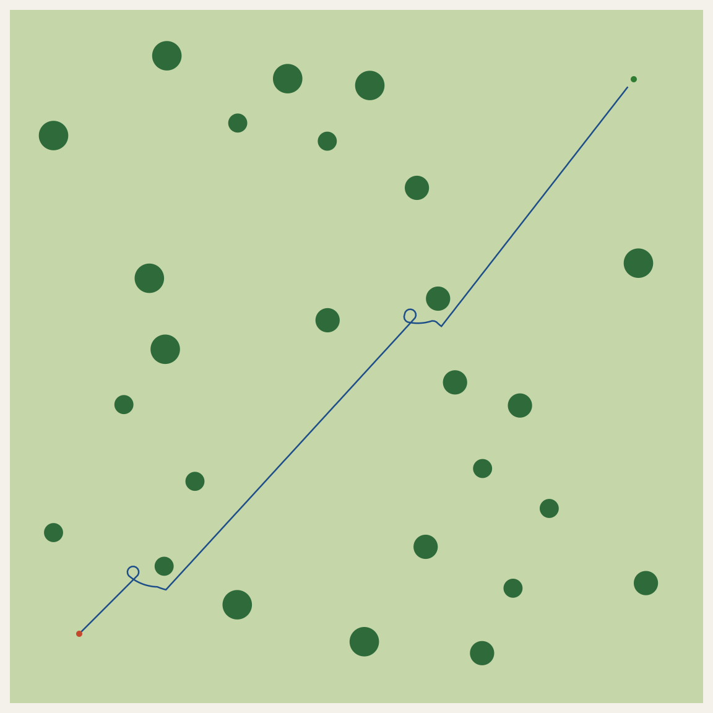

# Quad sim worlds

Indoor maze and outdoor forest for trying obstacle avoidance before a real flight. The same floor plan is in a Python demo, a Gazebo world, and a Webots world. The quad carries a lidar and a depth camera. Walls and trees have collision geometry, so a vehicle stops instead of flying through them.

The avoidance plugin is `sim/avoid.py`. It is the piece to read. Gazebo and Webots are only viewers for the same layout.

## How the pieces fit



`sim/worlds.py` holds the maze walls and the tree positions. `python3 -m sim.export` writes the Gazebo and Webots files from that. The demo casts a 360° lidar against those shapes and calls the plugin every tenth of a second.

## Quick start

Python 3.9 or newer. No packages to install.

```bash
python3 -m sim.demo indoor
python3 -m sim.demo outdoor
python3 -m sim.demo --check
```

`--check` flies both worlds and exits non-zero if either one misses the green goal. A top-down picture of the path is written to `media/`.





Indoor run from the check: goal in 38.2 s, path 50.3 m. Outdoor: goal in 35.3 s, path 51.1 m.

## The plugin

`Avoider.step(x, y, yaw, angles, ranges)` returns a world-frame velocity.

- Angles are body-frame radians. `0` is forward, positive is left.
- Ranges are meters, one per angle.
- If the front cone is clear, fly toward the goal.
- If something is inside 1.1 m ahead, follow the wall on the left until the goal bearing is clear and the quad is closer than when it started following.

That is the whole behavior. A bump from the demo calls `mark_blocked`, which starts the wall follow.

## Worlds

| World | Size | What is in it | Start | Goal |
| --- | --- | --- | --- | --- |
| Indoor maze | 18 m × 14 m | Room with two baffles. Lower gap is on the east side, upper gap is on the west side. | (2, 2) | (15, 12) |
| Outdoor forest | 40 m × 40 m | 26 trees, spaced so a small quad can pass between them. | (4, 4) | (36, 36) |

Edit the numbers in `sim/worlds.py`, then regenerate the viewers:

```bash
python3 -m sim.export
```

## Gazebo

The SDF files target Gazebo Sim (Harmonic or newer).

```bash
gz sim gazebo/indoor_maze.sdf
gz sim gazebo/outdoor_forest.sdf
```

The quad model is static, parked at the start, so the world opens without a flight stack holding it up. The planar lidar publishes on `lidar`. The depth camera publishes on `depth`. Wall and tree collisions are solid. Indoor walls are 2.4 m tall.

## Webots

Open `worlds/indoor_maze.wbt` or `worlds/outdoor_forest.wbt` in Webots R2023b or newer. The scout robot uses `controllers/avoid_controller`, which imports the same `Avoider`. The controller moves the robot from lidar, GPS, and the goal for that world. It only runs inside Webots, because that is where the `controller` module exists.

## ArduPilot

This repo does not include the ArduPilot tree or an iris flight model. Use it as the environment: the floor plan, the lidar, and the depth camera. Point a SITL session you already run at these worlds, or call `Avoider.step` from a companion computer that already has pose and a lidar scan. Practice the path here before the same idea goes on a real airframe.
